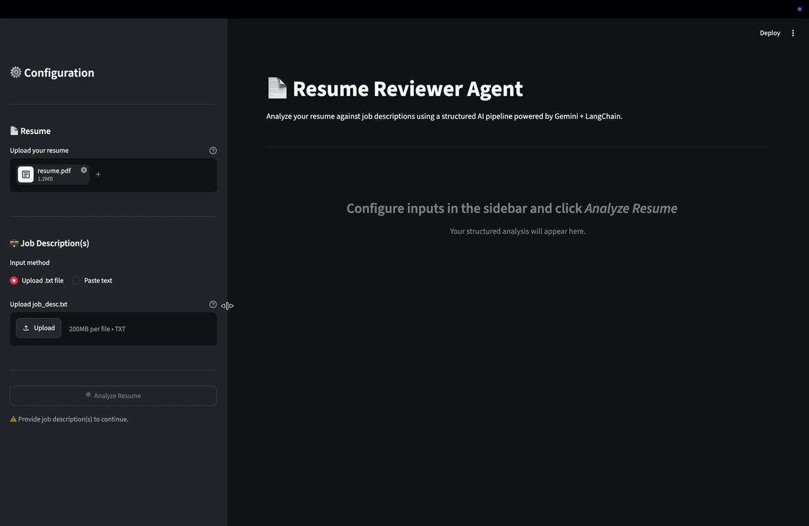

# ResumeReviewer Agent

A production-ready agentic AI application that analyzes a candidate's resume against one or more job descriptions and returns a structured, actionable report. Built with LangChain Expression Language (LCEL), Google Gemini, Pydantic, and Streamlit.

---

## Demo

<!-- Replace the placeholder below with your screen-recording GIF -->
<!--  -->

---

## Pipeline Architecture

```
┌─────────────────────────────────────────────────────────────────┐
│                         Streamlit UI                            │
│                                                                 │
│   Sidebar                          Main Dashboard               │
│   ┌──────────────────┐             ┌───────────────────────┐    │
│   │  Resume Upload   │             │  Jobs Analyzed        │    │
│   │  (.pdf/.docx)    │             │  Matching Skills      │    │
│   │                  │             │  Missing Skills       │    │
│   │  Job Description │             │  Skill Gap Summary    │    │
│   │  (file / paste)  │             │  Bullet Rewrites      │    │
│   │                  │             │  Download Report      │    │
│   │  [Analyze]       │             └───────────────────────┘    │
│   └──────────────────┘                                          │
└────────────────┬────────────────────────────────────────────────┘
                 │
                 ▼
┌─────────────────────────────────────────────────────────────────┐
│                       Document Parsing                          │
│                                                                 │
│   load_resume_text()                                            │
│   ┌──────────────────────────────────────────────┐             │
│   │  .pdf  ──►  PyMuPDFLoader  ──►  plain text   │             │
│   │  .docx ──►  UnstructuredWordDocumentLoader   │             │
│   └──────────────────────────────────────────────┘             │
│                                                                 │
│   load_and_clean_job_descriptions()                             │
│   ┌──────────────────────────────────────────────┐             │
│   │  raw text  ──►  split on "------"            │             │
│   │            ──►  strip boilerplate lines      │             │
│   │            ──►  collapse whitespace          │             │
│   └──────────────────────────────────────────────┘             │
└────────────────┬────────────────────────────────────────────────┘
                 │
                 ▼
┌─────────────────────────────────────────────────────────────────┐
│                      LCEL Chain (cached)                        │
│                                                                 │
│   ChatPromptTemplate                                            │
│   ┌──────────────────────────────────────────────┐             │
│   │  system: Senior Technical Recruiter persona  │             │
│   │  human:  {resume_context} + {job_data}       │             │
│   └──────────────────────┬───────────────────────┘             │
│                          │                                      │
│                          ▼                                      │
│   ChatGoogleGenerativeAI (gemini-2.5-flash, temp=0.1)          │
│   .with_structured_output(ResumeAnalysisReport)                │
│                          │                                      │
│                          ▼                                      │
│   ResumeAnalysisReport  (Pydantic)                             │
│   ┌──────────────────────────────────────────────┐             │
│   │  extracted_jobs    List[JobTarget]            │             │
│   │  matching_skills   List[str]                  │             │
│   │  missing_skills    List[str]                  │             │
│   │  skill_gap_summary str                        │             │
│   │  bullet_rewrites   List[ActionableRewrite]    │             │
│   └──────────────────────────────────────────────┘             │
└────────────────┬────────────────────────────────────────────────┘
                 │
                 ▼
┌─────────────────────────────────────────────────────────────────┐
│                         Output Layer                            │
│                                                                 │
│   format_report_text()  ──►  human-readable string             │
│   save_to_history()     ──►  resume_analysis_history.txt       │
│   st.download_button()  ──►  .txt download in browser          │
└─────────────────────────────────────────────────────────────────┘
```

---

## Project Structure

```
ResumeReviewer-Agent/
├── app.py                        # Streamlit application (entry point)
├── environment.yml               # Conda environment specification
├── resume_analysis_history.txt   # Append-only run log (auto-created)
├── .env                          # API keys (not committed)
├── assets/
│   └── demo.gif                  # Screen recording for README
└── dev/
    ├── main.ipynb                # Prototyping notebook
    └── data/
        ├── resume.pdf
        ├── job_desc.txt
        └── resume_analysis_history.txt
```

---

## Key Components

### `load_resume_text(file_path: str) -> str`

Accepts an absolute path to a `.pdf`, `.doc`, or `.docx` file and returns a cleaned plain-text string. PDF pages are joined with double newlines and passed through `PyMuPDFLoader`. Word documents are handled via `UnstructuredWordDocumentLoader`. Non-breaking spaces (`\xa0`) and redundant whitespace are normalized in both cases.

In the Streamlit app, the uploaded file object is written to a `tempfile` before being passed to this function, keeping LangChain's file-based loaders compatible with Streamlit's in-memory upload objects.

---

### `load_and_clean_job_descriptions(text: str) -> str`

Accepts raw job description text — either read from an uploaded `.txt` file or pasted directly by the user. Multiple postings are delimited by a line containing only `------`. The function performs two cleanup passes:

1. **Structural pass** — splits on the delimiter, strips surrounding whitespace, and collapses runs of blank lines.
2. **Boilerplate removal** — filters out LinkedIn UI artifacts (e.g., "Easy Apply", "Save", "Message") that pollute copy-pasted job descriptions before they reach the LLM context window.

---

### Pydantic Schema — `ResumeAnalysisReport`

Forces the LLM to return a validated, typed JSON object rather than free-form text. The schema is composed of three models:

| Model | Fields |
|---|---|
| `JobTarget` | `company_name`, `job_title` |
| `ActionableRewrite` | `current_text`, `suggested_text`, `reasoning` |
| `ResumeAnalysisReport` | `extracted_jobs`, `matching_skills`, `missing_skills`, `skill_gap_summary`, `bullet_rewrites` |

LangChain's `.with_structured_output()` uses the Pydantic field descriptions as schema hints passed to the model, ensuring consistent, parseable output across runs.

---

### LCEL Chain — `get_chain()`

Assembled once and cached via `@st.cache_resource` to avoid rebuilding on every Streamlit re-run.

```python
chain = ChatPromptTemplate.from_messages([...]) | llm.with_structured_output(ResumeAnalysisReport)
report = chain.invoke({"resume_context": ..., "job_data": ...})
```

The pipe operator (`|`) is LangChain Expression Language syntax. Each component is a `Runnable`; they compose into a single callable that handles prompt formatting, API calls, and Pydantic validation in sequence.

---

### `format_report_text(report) -> str` and `save_to_history()`

`format_report_text` converts the structured Pydantic object into the same human-readable format used in the prototyping notebook, prepended with a UTC timestamp and the list of target positions. `save_to_history` appends this string to `resume_analysis_history.txt`, providing a persistent, append-only log of every analysis run.

---

## Getting Started

### 1. Clone the repository

```bash
git clone https://github.com/hamzasiddiqui10/ResumeReviewer-Agent.git
cd ResumeReviewer-Agent
```

### 2. Create the conda environment

```bash
conda env create -f environment.yml
conda activate agentic
```

### 3. Configure environment variables

Create a `.env` file in the project root:

```
GEMINI_API_KEY=your_gemini_api_key_here
LANGCHAIN_TRACING_V2=false
LANGSMITH_TRACING=false
LANGCHAIN_API_KEY=your_langsmith_api_key_here
```

`LANGCHAIN_TRACING_V2` and `LANGCHAIN_API_KEY` enable [LangSmith](https://smith.langchain.com) tracing. Both are optional — omit them if you do not need observability.

### 4. Create the history log file

```bash
touch resume_analysis_history.txt
```

### 5. Run the application

```bash
streamlit run app.py
```

The app opens at `http://localhost:8501` by default.

---

## Usage

1. Upload your resume (`.pdf`, `.docx`, or `.doc`) in the sidebar.
2. Provide job descriptions either by uploading a `.txt` file or pasting the text directly. Separate multiple postings with a line containing only `------`.
3. Click **Analyze Resume**.
4. Review the structured report in the main dashboard — matching skills, missing skills, skill gap summary, and bullet-point rewrite suggestions.
5. Download the full report as a `.txt` file or find it appended to `resume_analysis_history.txt`.

---

## Tech Stack

| Component | Library / Service |
|---|---|
| LLM | Google Gemini 2.5 Flash via `langchain-google-genai` |
| Orchestration | LangChain Expression Language (LCEL) |
| Structured Output | Pydantic v2 |
| PDF Parsing | PyMuPDF via `langchain-community` |
| DOCX Parsing | Unstructured via `langchain-community` |
| Frontend | Streamlit |
| Environment | Conda / Python 3.11 |

---

## License

MIT
